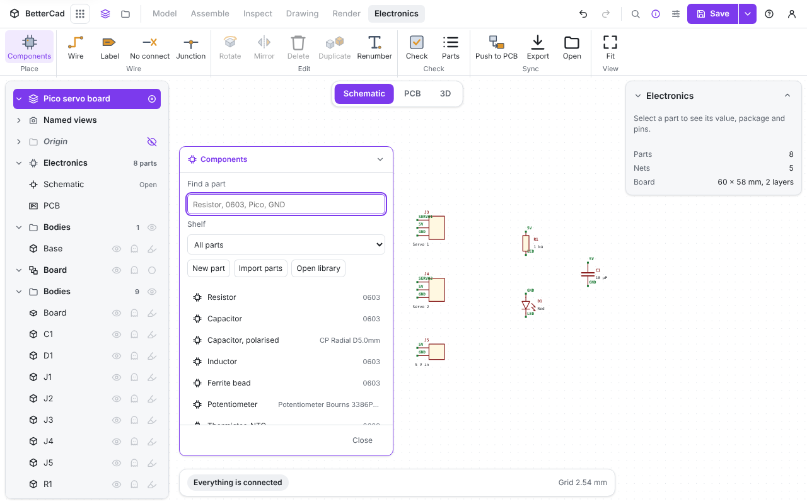

# Electronics: the guide

BetterCad has an electronics workspace: draw a schematic, lay out a 2-layer board, see it in 3D beside the parts you
print, and save the files a board house needs. This is the guide for people using it. How it is built is in
[electronics.md](electronics.md); the parts library is in [electronics-library.md](electronics-library.md).

Open it from the Electronics tab on the top bar. Three views share one design, and a switcher at the top of the view
moves between them: Schematic (1), PCB (2) and 3D (3). A part you pick in one view stays picked in the others.

Want to see a finished one first? On an empty schematic, choose Open the sample board. It is a carrier for a
Raspberry Pi Pico with two servo headers, routed and ready to order. The lesson
[Your first board](lessons/your-first-board.md) walks through it.

## Draw the schematic

1. **Place parts.** Press P for Components. Type what you want ("10k", "header 3", "pico"), pick a part and a
   package, and choose Place. Click to set it down; R turns it, X flips it left to right and Y flips it top to bottom while it is on the pointer. Esc lets
   go of it.
2. **Wire the pins.** Press W and click a pin, then click where the wire should bend, then the pin it goes to. A wire
   that ends on another wire joins it. Wires that only cross do not join; press J and click the crossing to join them
   with a dot.
3. **Name nets.** Press L, type a name and click a wire. Wires with the same name are joined, on one sheet or across
   sheets, so you can keep the drawing tidy without long wires. Power symbols (5V, GND) are in Components and join
   by name the same way.
   A bigger design goes on more than one sheet: the plus beside the sheet tabs adds one, and right-click on a tab
   renames, moves, deletes or duplicates it. Duplicate copies a sheet as a block to use again, with its own part
   references. A label that carries on to another sheet says which; pick it to go there.
4. **Mark pins you leave open.** Press Q and click the pin, so the rules check knows it is on purpose.
5. **Check it.** Press E for the rules check. It lists pins left unconnected, outputs wired together, nets with one
   pin and more, each with a way to fix it. Click a line to go to the spot.

The parts table (T) shows every part in one table. Change values, packages and part numbers there, several rows at a
time. Export saves the schematic as a PDF or an SVG, a netlist, or the whole design as a KiCad project.

On a phone or tablet the tools sit along the bottom, and you tap where you would click.

## Find and make parts

Components opens with a starter library of a couple of hundred parts: resistors, capacitors, LEDs, headers, common
chips, modules such as the Raspberry Pi Pico, and connectors. Each shows its symbol, its packages and where it came
from. Star the ones you use.

- **New part** makes your own: paste a pin list for the symbol, pick a package family and type its sizes, and save it
  to your parts.
- **Import parts** brings in KiCad files (.kicad_sym with the .kicad_mod footprints they use) or Eagle libraries
  (.lbr). Say where they are from and their licence; both are kept on every part.
- Your parts are kept in this browser, and with your account when you are signed in. Export saves them as one file
  you can share, and Open library adds a file somebody shared with you.

## Lay out the board

Choose Push to PCB in the schematic. It lists what it will do (make the board, add each part) before you say yes.
After that, the PCB tab shows how many changes the board is behind whenever the schematic has moved on; Update from
schematic brings it up to date and lists the changes first.

1. **Set up the board.** Press B for Board setup: width, height, corner radius and thickness, or take the outline
   from a sketch in your model so the board fits the case you are printing. You can also right-click a body, a flat
   face or a sketch and choose **Use as PCB profile**: a body gives its biggest flat face, and holes through it become
   cut-outs. The board follows its source, so when you change the model the board's shape changes with it, and one
   undo takes back both. If the face or sketch goes away, the board keeps its last shape and you are told.
   Pick a board house's rules here too.
   Most boards need two copper layers. Layers gives you four or six: the inner ones show in the Layers card, L steps
   through them while you route, and a pour over the whole board on an inner layer makes it a ground or power plane.
2. **Place the parts.** Drag them into place. R turns a part, X flips it to the other side of the board, K locks it.
   Thin lines show which pads still need joining.
3. **Route.** Press W and click a pad. Each click lays a piece of track with a 45° bend; click the pad it goes to and
   the track ends. Press V to drop a via and carry on on the other side. With Keep clear on, a track stops before it
   comes too close to anything else and says what is in the way. Or choose Autoroute: it lays tracks for the
   connections still to make, on both sides or one, and leaves your own tracks where they are. Stop keeps what it
   has done, and one undo takes its tracks out. It suits simple boards and finishing off; it lists any connection
   it finds no way for.
   Turn on Push and a track you lay moves other tracks aside to make room, keeping every gap. Pair routes two nets
   such as D+ and D- side by side: start on one pad, click the line between them, and both tracks follow at the
   same gap. The bar shows how long the net is as you go; type a Target length to see it against that. To make a
   net longer, pick one of its tracks and type the length you want: it gets wiggles to make it up.
4. **Pour copper.** Press P and draw round an area, usually the whole board for ground. The pour keeps clear of
   other nets and joins its own pads with spokes.
5. **Add holes and text.** H adds a mounting hole for a screw. T writes on the silkscreen.
6. **Check it.** Press E for the board check. It finds shorts, gaps that are too small, connections left to route,
   copper too close to the edge, holes too small or too close together and text too small to print, against the
   rules you picked.

Layers, bottom right, shows and hides each layer and sets the grid.

## See it in 3D

Press 3. The board stands in your model as a step on the timeline, with a simple body for each part, so you can
check that it fits its case, that a connector lines up with its opening and that screws meet their holes. The
board's copper and silkscreen are drawn on its faces. Change the board and the model follows.

## Order it

Choose Order in the PCB view. [Ordering a board](electronics-ordering.md) goes through it step by step for JLCPCB
and PCBWay. It can also make a panel of several boards, save an assembly drawing of each side, and save the whole
board as one IPC-2581 file for an assembler that asks for one.

## Bring a design in, or take it out

- **Open project**, in the schematic's tools, opens a KiCad project (.kicad_sch, .kicad_pcb, .kicad_pro) or an Eagle
  or Fusion Electronics schematic and board (.sch, .brd). You see what was found and what did not come across before
  it replaces the design you have. Undo brings yours back.
- **Export**, KiCad, saves the whole design as a KiCad project in a zip: every sheet, the board and a library of the
  parts you used. Your work is never locked in.

## Keys

| | Schematic | PCB |
| --- | --- | --- |
| Views | 1 schematic, 2 PCB, 3 model | the same |
| Place | P Components | drag a part |
| Join | W wire, L net label, J junction, Q not connected | W route, V via, L swap side, / bend the other way |
| Add | | H hole, T text, P pour |
| Change | R rotate, X mirror, Del delete, Ctrl+D duplicate | R rotate, X flip side, K lock, Del delete |
| Check | E rules check, T parts table | E board check, B board setup |
| View | F fit | F fit |

On a Mac, Ctrl is Cmd. Press ? in the app for every shortcut.

## What it does not do yet

Boards have two, four or six copper layers, with our own usual builds and not a board house's. Autoroute routes simple boards and does not push tracks aside. Push moves tracks, not vias or parts. A model holds
one board. Part bodies in 3D are simple shapes, not the makers' own models. Part numbers for assembly are typed in,
not looked up. The developer notes in [electronics.md](electronics.md) list the rest.
