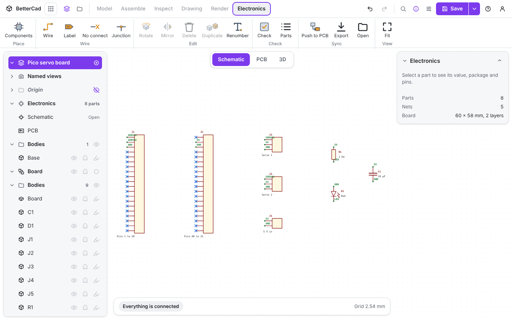
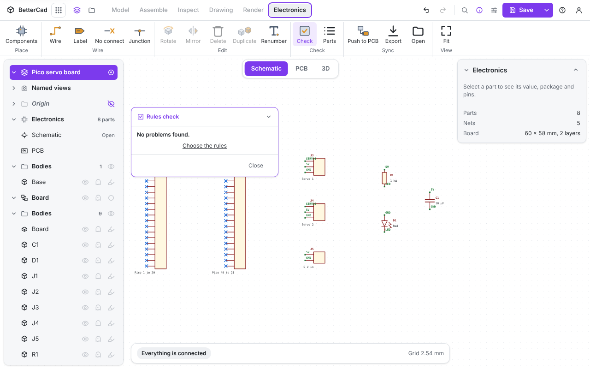
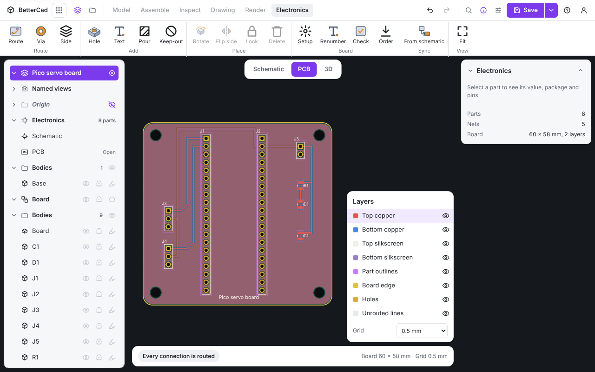
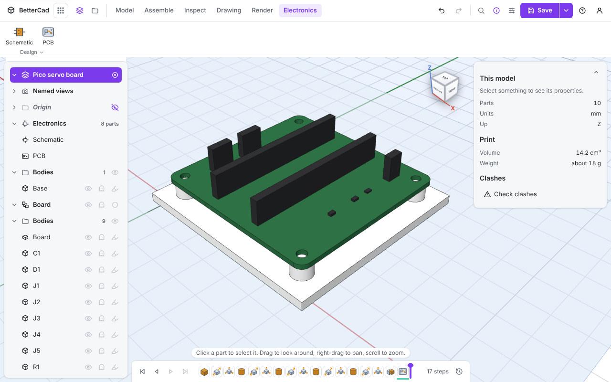

# Electronics: the guide

BetterCad has an electronics workspace: draw a schematic, lay out a 2-layer board, see it in 3D beside the parts you
print, and save the files a board house needs. This is the guide for people using it. How it is built is in
[electronics.md](electronics.md); the parts library is in [electronics-library.md](electronics-library.md).

Open it from the Electronics tab on the top bar: it opens the view you used last in this model, or the schematic. Three views share one design, and a switcher at the top of the view
moves between them: Schematic (1), PCB (2) and 3D (3). A part you pick in one view stays picked in the others.

Want to see a finished one first? On an empty schematic, choose Open the sample board. It is a carrier for a
Raspberry Pi Pico with two servo headers, routed and ready to order. The lesson
[Your first board](lessons/your-first-board.md) walks through it.

## Draw the schematic

1. **Place parts.** Press P for Components. Type what you want ("10k", "header 3", "pico"), pick a part and a
   package, and choose Place. Click to set it down; R turns it, X flips it left to right and Y flips it top to bottom while it is on the pointer. Esc lets
   go of it.
2. **Wire the pins.** Press W and click a pin, then click where the wire should bend, then the pin it goes to. A wire
   that ends on another wire joins it. Wires that only cross do not join; press J and click the crossing to join them
   with a dot.
3. **Name nets.** Press L, type a name and click a wire. Wires with the same name are joined, on one sheet or across
   sheets, so you can keep the drawing tidy without long wires. Power symbols (5V, GND) are in Components and join
   by name the same way.
   A bigger design goes on more than one sheet: the plus beside the sheet tabs adds one, and right-click on a tab
   renames, moves, deletes or duplicates it. Duplicate copies a sheet as a block to use again, with its own part
   references. A label that carries on to another sheet says which; pick it to go there.
   To use a sheet as a block, pick the labels where it joins the rest and choose Sheet pin, then right-click its tab
   and choose Place on this sheet as a box. The box has a pin for each sheet pin; wire them up like a part's.
   Place it again for a second use: each use has its own parts, references and nets, but the drawing is one, so a
   change to the first sheet shows on every copy. Double-click a box to open its sheet. On the PCB, Repeat its board
   layout on the copies (on the same tab menu) lays the copies out as you laid out the first. Boxes go to KiCad as
   hierarchical sheets, one file for the block, and come back the same.
4. **Write on the sheet.** The Draw group has Text, Line, Box and Circle, for titles, notes and boxes round a
   group of parts. Double-click a text note to change its words. Notes don't join anything.
5. **Mark pins you leave open.** Press Q and click the pin, so the rules check knows it is on purpose.
6. **Check it.** Press E for the rules check. It lists pins left unconnected, outputs wired together, nets with one
   pin and more, each with a way to fix it. Click a line to go to the spot. Choose the rules shows a table of which
   pin types may meet; click a cell to make that pair fine, a warning or an error.

The parts table (T) shows every part in one table. Change values, packages and part numbers there, several rows at a
time. Export saves the schematic as a PDF or an SVG, a netlist, or the whole design as a KiCad project. To make more than one build of a board, such as
one without the charger, choose New variant in the parts table: Values and Fitted then change that build only, and
Order the board asks which build to make the parts list and pick and place for.

On a phone or tablet the tools sit along the bottom, and you tap where you would click.

## Build from blocks

Not sure how a motor driver or a battery charger is wired? Use a block. A block is a small circuit that is already
drawn and checked: the parts, how they join, and the points you join to the rest of your design. There are 19 on the
Blocks shelf: power (USB-C, LiPo charger and protection, 5 V boost, 3.3 V regulators), motor drivers, servo headers,
level shifters, Qwiic and other connectors. More about each is in [electronics-blocks.md](electronics-blocks.md).

1. **Place one.** Press P for Components and choose Blocks. Pick a block to read what it does and what it needs,
   then choose Place and click the sheet. It lands in an outline with its name on top, and its points on the edge.
2. **Join it up.** Pick the block. The card lists its points: Joined, Open or Needed, with the voltage each one
   takes. Connect to… beside a point offers the pins and points it can safely join; Join I2C joins SDA and SCL to a
   free I2C pair on your microcontroller in one go. Ground joins by itself.
3. **Check it.** The rules check (E) says when a Needed point is open, when two outputs drive one net, when a 5 V
   output feeds a 3.3 V input, and when an I2C bus has no pull-ups or too many.
4. **Tidy up.** Drag the outline to move the whole block. Fold to a box hides its inside and leaves its points;
   double-click it to open it again. Double-click inside an open block to pick one part.

You can group your own parts too: pick them and press Ctrl+G (Cmd+G on a Mac) for Group. The outline moves as one
and keeps its name; Shift+Ctrl+G takes it apart. Save as block on a group's card keeps it in Your library to use
again, or Export saves it as a file to share.

Your design keeps its own copy of each block, so it never changes under you. When a block on the shelf moves on, the
copy shows an Update tag; the card says what changed, and Update swaps it for the new one with its points still
joined.

On the PCB a block's parts arrive together, laid out the way the block suggests, inside an outline with its name.
Pick the group from a part's card to move or turn them as one.

To see a whole board made this way, choose Open a board made from blocks on an empty schematic. The lesson
[Build a robot board from blocks](lessons/robot-board-from-blocks.md) makes it step by step.

## Find and make parts

Components opens with a starter library of a couple of hundred parts: resistors, capacitors, LEDs, headers, common
chips, modules such as the Raspberry Pi Pico, and connectors. Each shows its symbol, its packages and where it came
from. Star the ones you use.

- **New part** makes your own: paste a pin list for the symbol, pick a package family and type its sizes, and save it
  to your parts.
- **Import parts** brings in KiCad files (.kicad_sym with the .kicad_mod footprints they use) or Eagle libraries
  (.lbr). Say where they are from and their licence; both are kept on every part.
- Your parts are kept in this browser, and with your account when you are signed in. Export saves them as one file
  you can share, and Open library adds a file somebody shared with you.

## Lay out the board

Choose Push to PCB in the schematic. It lists what it will do (make the board, add each part) before you say yes.
After that, the PCB tab shows how many changes the board is behind whenever the schematic has moved on; Update from
schematic brings it up to date and lists the changes first.

1. **Set up the board.** Press B for Board setup: width, height, corner radius and thickness, or take the outline
   from a sketch in your model so the board fits the case you are printing. You can also right-click a body, a flat
   face or a sketch and choose **Use as PCB profile**: a body gives its biggest flat face, and holes through it become
   cut-outs. The board follows its source, so when you change the model the board's shape changes with it, and one
   undo takes back both. If the face or sketch goes away, the board keeps its last shape and you are told.
   Pick a board house's rules here too, and whether vias are covered by the mask or left open. A via's own card can
   say otherwise for that one. Custom rules, at the bottom, give more room between two net classes (mains and
   logic), or a clearance and track width of their own inside an area, such as under a fine-pitch chip.
   Most boards need two copper layers. Layers gives you four or six: the inner ones show in the Layers card, L steps
   through them while you route, and a pour over the whole board on an inner layer makes it a ground or power plane.
2. **Place the parts.** Drag them into place. R turns a part, X flips it to the other side of the board, K locks it.
   Thin lines show which pads still need joining. Pick a track or a via and its net's section can give the net a
   colour for its lines, or hide them, handy for ground before the pour is drawn. Hidden lines still count as left
   to route.
3. **Route.** Press W and click a pad. Each click lays a piece of track with a 45° bend; click the pad it goes to and
   the track ends. Press V to drop a via and carry on on the other side. With Keep clear on, a track stops before it
   comes too close to anything else and says what is in the way. Or choose Autoroute: it lays tracks for the
   connections still to make, on both sides or one, and leaves your own tracks where they are. Stop keeps what it
   has done, and one undo takes its tracks out. It suits simple boards and finishing off; it lists any connection
   it finds no way for.
   Turn on Push and a track you lay moves other tracks aside to make room, keeping every gap. Pair routes two nets
   such as D+ and D- side by side: start on one pad, click the line between them, and both tracks follow at the
   same gap. The bar shows how long the net is as you go; type a Target length to see it against that. To make a
   net longer, pick one of its tracks and type the length you want: it gets wiggles to make it up.
4. **Pour copper.** Press P and draw round an area, usually the whole board for ground. The pour keeps clear of
   other nets and joins its own pads with spokes. Pour both sides, then pick a pour and press **Add stitching vias** to join them with vias every few millimetres.
5. **Add holes and text.** H adds a mounting hole for a screw. T writes on the silkscreen. If a board house will
   put the parts on, add three **Fiducials** near the corners, not in a line, so its camera can line the board up.
   A **Test point** clicked onto a track gives your meter's probe somewhere to land.
   To repeat a routed channel, pick its parts, press Ctrl+C, pick the matching parts of the next channel and press
   Ctrl+V. They are laid out and routed the same way, on their own nets.
6. **Check it.** Press E for the board check. It finds shorts, gaps that are too small, connections left to route,
   copper too close to the edge, holes too small or too close together and text too small to print, against the
   rules you picked.

Layers, bottom right, shows and hides each layer and sets the grid. Pours are drawn light so tracks over them stand
out, and the side you are not working on is dimmed; turn on Pours as outlines to see only their edges. Text on the
board is drawn in the same stroke font the Gerber files use, so what you see is what is printed.

Calculators, on the ribbon in both views, works out the width a track needs for a current, the current a via
carries, the resistor for an LED and a resistor's colour bands. A track width can be made a net class's width.

Press M to measure: click two points to read the distance between them, and its dx and dy. Pad, via and hole
centres, track ends and the board's edge snap. Press Ctrl+F in either view to find a part by its reference, value or
part number, or a net by its name: choosing a result goes to it, on whichever sheet it is, and picks it.

## Simulate it

Choose Simulate, in the schematic's tools, to run the circuit on ngspice and see the voltage on a net over time. Pick
the nets to probe (up to six), or select one on the schematic and choose Probe. Rails take their voltage from their
name (5V, +3V3, +12V, VBUS); give VCC, VIN and other rails one in the card. Drive a net to put a square wave, a sine
wave or a steady voltage on it, such as a switch's or a sensor's, and set how long the run lasts. Run draws each probe
in its own colour. The settings are saved with the design.

Resistors, capacitors, inductors, potentiometers (at their middle), diodes, LEDs (by colour), zeners (by their
value), transistors, MOSFETs and batteries are simulated with typical models, close enough to see a filter settle or a
transistor switch an LED, not the makers' own. Chips, connectors and switches are left out and listed, so you can see
what the run ignores. The simulator downloads the first time you run it, about 5 MB.

## Script it

Choose Script to run JavaScript on the design: lay LEDs out in a ring, set every capacitor to one value, or write
a parts list for your supplier. Scripts read and change the design through `bc`:

- Read: `bc.parts()`, `bc.sheets()`, `bc.nets()`, `bc.board()`, `bc.erc()` and `bc.drc()`. Each gives a copy.
- Change the schematic: `bc.setValue(ref, value)`, `bc.setFitted(ref, false)`, `bc.setPartNumber(ref, { lcsc })`,
  `bc.addLabel(name, [x, y])`, `bc.wire([x, y], [x, y])`, `bc.place(ref, [x, y])` (a copy of a part) and
  `bc.renumber()`.
- Change the board: `bc.move(ref, [x, y], turn, side)`, `bc.addTrack(net, points)`, `bc.addVia(net, [x, y])`,
  `bc.setRule(rule, value)` and `bc.setNetClass(net, className)`.
- Show what it found: `bc.say(...)`, `bc.table(rows)` and `bc.file(name, text)`, which you can save.

Run shows what the script would change, in words and lit up on the view; nothing changes until you choose Keep,
which makes it one step you can undo. Scripts run in a sandbox: they can't reach the network or your files, and
stop after 10 s. Start from one of the starter plug-ins to see how they work.

Give a script a name and choose Save as a plug-in to keep it in Your plug-ins, with your parts and blocks, in your
account when you are signed in. Save the file saves it as a `.bcplugin.js` file to pass on; Open a file opens one.

## See it in 3D

Press 3. The board stands in your model as a step on the timeline, with a simple body for each part, so you can
check that it fits its case, that a connector lines up with its opening and that screws meet their holes. The
board's copper and silkscreen are drawn on its faces. Change the board and the model follows.

## Order it

Choose Order in the PCB view. [Ordering a board](electronics-ordering.md) goes through it step by step for JLCPCB
and PCBWay. It can also make a panel of several boards, save an assembly drawing of each side, and save the whole
board as one IPC-2581 file for an assembler that asks for one.

## Bring a design in, or take it out

- **Open project**, in the schematic's tools, opens a KiCad project (.kicad_sch, .kicad_pcb, .kicad_pro) or an Eagle
  or Fusion Electronics schematic and board (.sch, .brd). You see what was found and what did not come across before
  it replaces the design you have. Undo brings yours back.
- **Export**, KiCad, saves the whole design as a KiCad project in a zip: every sheet, the board and a library of the
  parts you used. Your work is never locked in.

## Keys

| | Schematic | PCB |
| --- | --- | --- |
| Views | 1 schematic, 2 PCB, 3 model | the same |
| Place | P Components | drag a part |
| Join | W wire, L net label, J junction, Q not connected | W route, V via, L swap side, / bend the other way |
| Add | | H hole, T text, P pour |
| Change | R rotate, X mirror, Del delete, Ctrl+D duplicate | R rotate, X flip side, K lock, Del delete |
| Check | E rules check, T parts table, Simulate in the tools | E board check, B board setup |
| View | F fit, Ctrl+F find | F fit, M measure, Ctrl+F find |

On a Mac, Ctrl is Cmd. Press ? in the app for every shortcut.

## What it does not do yet

Boards have two, four or six copper layers, with our own usual builds and not a board house's. Autoroute routes simple boards and does not push tracks aside. Push moves tracks, not vias or parts. A model holds
one board. Part bodies in 3D are simple shapes, not the makers' own models. Part numbers for assembly are typed in,
not looked up. The developer notes in [electronics.md](electronics.md) list the rest.
