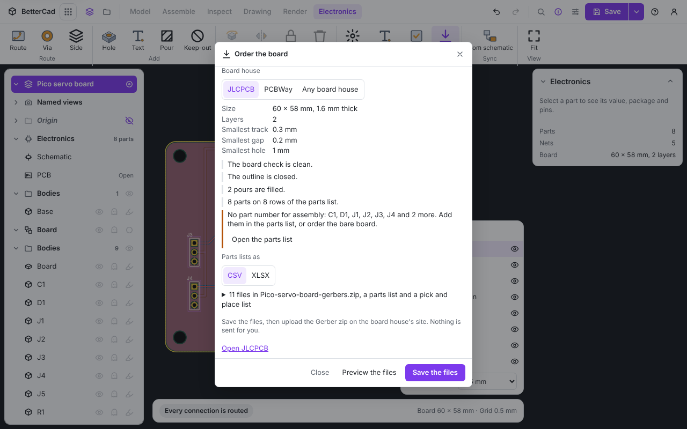
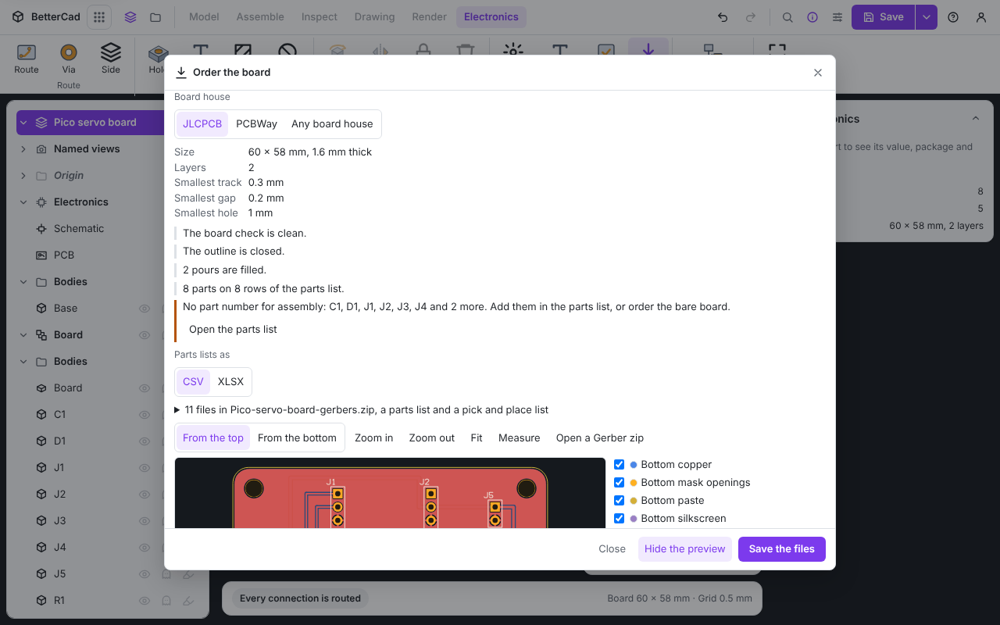
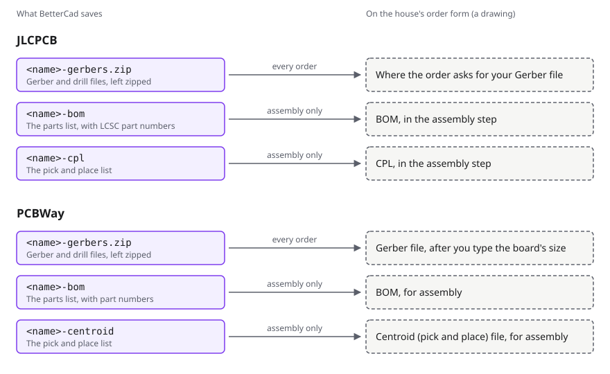

# Ordering a board

How to get from a finished layout to a board in the post. BetterCad saves the files a board house asks for, named
and laid out the way that house reads them. It does not upload anything or place an order: you do that on the
house's own site, where you also see the price and their preview before you pay.

What each house asks for was read from its own help pages on 24 November 2026 (the pages are listed at the end).
Board houses change their pages. If a file is refused, check the page and tell us with Help, Report a problem.

## 1. Check the board

In the PCB view, press E for the board check and clear every error. The order card will tell you the same thing,
but it is quicker to fix problems while you are looking at the board.

## 2. Open Order

Choose Order in the PCB view's tools.

- **Board house.** Pick JLCPCB or PCBWay. Any board house gives plain names and every column, for anyone else.
- **The facts.** Size, layers, thickness, smallest track, smallest gap and smallest hole. These are the numbers an
  order form asks for; type them in as you see them here.
- **The checklist.** The board check is clean, the outline is closed, the pours are filled, and every part has what
  that house needs to fit it. Only an open outline or pours that run into each other stop you saving. A missing part
  number matters only if the house is fitting the parts for you: for a bare board, carry on.
- **Order a panel of boards.** Rows and columns of the same board on one panel, joined by tabs (a milled gap,
  bridged, with a row of small holes to snap along) or V-cuts (a groove scored along straight lines; for
  rectangular boards only), with rails along the top and bottom. The size shown is then the panel's. Tell the
  board house it is a panel you made, and how the boards are joined: the tab and rail sizes are our own usual
  ones, so check them against the house's panel rules.
- **Parts lists as.** CSV or XLSX. Both houses take either.

## 3. Look at the files

Choose Preview the files. This draws the Gerber and drill files that were just written, not the design, so what you
see is what the house will read. Look from the top and from the bottom, tick layers on and off, and use Measure
between two points if you want to check a size. Text on the silkscreen is drawn here as it will be printed.

## 4. Save the files

Choose Save the files. You get one zip named for the board and the house, with three things in it:

| File | What it is | Who needs it |
| --- | --- | --- |
| `<name>-gerbers.zip` | The Gerber files, one a layer (copper, solder mask, paste and silkscreen for both sides, and the outline), and the drill files for plated and bare holes | Every order |
| `<name>-bom` (.csv or .xlsx) | The parts list: one row for each kind of part | Assembly only |
| `<name>-cpl` or `<name>-centroid` (.csv or .xlsx) | The pick and place list: where each part's middle is, which side it is on and how far it is turned | Assembly only |

Unzip the outer zip once. Leave `<name>-gerbers.zip` zipped: that is the file you upload.

The picture is a drawing of which file goes where, not a copy of either house's page.

## 5. Upload: JLCPCB

Their site leads you through the order. This is which file goes where:

1. Go to [jlcpcb.com](https://jlcpcb.com/) and start an order. Where it asks for your Gerber file, upload
   `<name>-gerbers.zip`.
2. Check the size and layers it reads against the facts on the order card.
3. For a bare board, that is every file they need.
4. For assembly, it asks for two more files. `<name>-bom` is the BOM and `<name>-cpl` is the CPL, their name for
   the pick and place file.
5. JLCPCB finds parts by the JLCPCB or LCSC part number ("C25804") on each row of the parts list. Add the numbers
   in the parts table before you save the files (Open the parts list, on the order card).
6. **Check their placement preview before you pay.** JLCPCB shows where it will put each part. Their pages do not
   say where positions are measured from or how parts on the bottom are turned, so look at every part there, and at
   pin 1 of each chip and the stripe of each diode.

The parts list has the columns Comment, Designator, Footprint and LCSC Part #. The pick and place list has
Designator, Mid X, Mid Y, Layer (Top or Bottom) and Rotation, in millimetres, turned anticlockwise.

## 6. Upload: PCBWay

Their site leads you through the order too. This is which file goes where:

1. Go to [pcbway.com](https://www.pcbway.com/) and start an order. Type the size, layers and thickness from the facts
   on the order card, and upload `<name>-gerbers.zip` as the Gerber file.
2. For a bare board, that is every file they need.
3. For assembly, `<name>-bom` is the BOM and `<name>-centroid` is the centroid (pick and place) file. PCBWay asks
   for Gerbers with at least silkscreen, copper and solder paste layers for assembly; the zip has them.
4. The parts list needs a part number for each row, and for an order where PCBWay buys the parts, the manufacturer
   and the manufacturer's part number as well. Fill them in in the parts table before you save the files.

The parts list has line number, quantity, reference designator, part number, description, package, type and the
manufacturer's and distributor's numbers. The centroid file has reference designator, X, Y, rotation and side, and
lists surface mount parts only.

## Before you order

- Order the smallest quantity first. Five boards from either house cost little, and the first board always teaches
  you something.
- Parts on the bottom, and parts whose library drawing is turned differently from the tape they come on, are where
  assembly goes wrong. A component can carry its own correction (a turn and a shift used only in the pick and place
  file) so you fix it once.
- Keep the zip you uploaded with the model. Save the model too: its timeline holds the board as you ordered it.

## What is not checked yet

Nobody has yet uploaded these files to either house and gone through to the quote. The Gerber and drill files are
tested by reading them back and by comparing them with what KiCad writes for the same board, and the parts lists
follow the houses' pages, but the pages do not give exact headings for every column (PCBWay's gives field names
only) or say how bottom parts are turned. The steps above say which file goes where and no more, because the click
by click of each site was not on the pages we read. The picture in step 4 is our own drawing; screenshots of the
houses' own upload pages will be added after a real order. Treat a first order as the test.

## Where the houses' needs were read

- JLCPCB: [How to generate the BOM and centroid file from KiCad](https://jlcpcb.com/help/article/how-to-generate-the-bom-and-centroid-file-from-kicad)
  and [Pick and place file for PCB assembly](https://jlcpcb.com/help/article/pick-place-file-for-pcb-assembly), read
  24 November 2026.
- PCBWay: [Assembly file requirements](https://www.pcbway.com/assembly-file-requirements.html), read 24 November 2026.

The same list, with the date, is in `packages/electronics/src/fab/houses.json`, which is what the order card uses.
